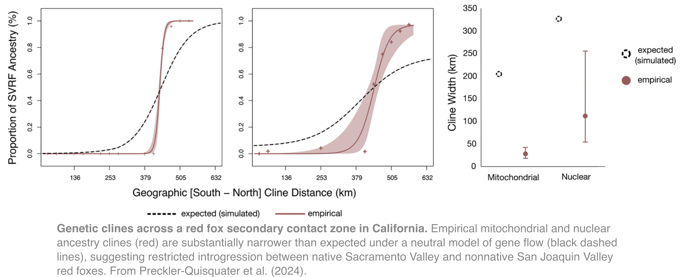

My research focuses on the evolutionary processes that shape diversification, adaptation, and persistence in mammals over recent evolutionary timescales. I am particularly interested in how evolutionary history and contemporary ecological conditions interact to influence evolutionary trajectories, and how human activities alter these processes by changing selective pressures, population sizes, and patterns of gene flow.

I integrate population and comparative genomics, ecological data, natural-history museum specimens, and computational modeling to investigate these questions across natural and human-modified environments. Much of my research focuses on carnivores, particularly canids, whose complex histories of diversification, hybridization, and responses to environmental change provide opportunities to investigate fundamental evolutionary processes with applications to biodiversity conservation.

## Research Themes
### Evolutionary divergence, hybridization, and secondary contact
*How do evolutionary history, selection, and demographic processes influence reproductive isolation and the outcomes of secondary contact?*

When historically isolated populations come into secondary contact, the extent of gene flow between them depends on their evolutionary histories, reproductive barriers, and the ecological conditions under which they interact. My research investigates how these processes shape genomic differentiation and introgression, particularly in closely related canid lineages.

My doctoral research examined two contrasting systems: native and introduced red fox (*Vulpes vulpes*) populations in California and deeply divergent eastern and western gray fox (*Urocyon cinereoargenteus*) lineages in North America. Despite their relatively recent divergence, native and introduced red fox populations maintain an unexpectedly narrow hybrid zone, potentially reflecting reproductive barriers associated with selection during the introduced lineage's history of captive breeding. In contrast, gray fox lineages that diverged approximately one million years ago exhibit comparatively weak evidence of reproductive isolation following secondary contact.

These findings raise broader questions about how divergence time, historical demography, and selection interact to shape the evolution of reproductive barriers. My ongoing research expands genomic and morphological sampling across the gray fox contact zone and investigates the evolutionary history of kit foxes, swift foxes, and arctic foxes, including the roles of historical introgression and adaptation to arid environments.

**Selected publications**

* Preckler-Quisquater et al. (2024). Maintenance of a narrow hybrid zone between native and introduced red foxes despite conspecificity and high dispersal capabilities. Molecular Ecology.

* Preckler-Quisquater et al. (2023). Can demographic histories explain long-term isolation and recent pulses of asymmetric gene flow between highly divergent gray fox lineages? Molecular Ecology.

### Ecological differentiation and evolution across contrasting environments
*How do ecological conditions influence phenotypic and genomic differentiation, and when might these changes reinforce population divergence?*

Environmental heterogeneity creates opportunities for populations to diverge in morphology, behavior, resource use, and genetic composition. I am interested in how these responses emerge across contrasting environments, particularly when ecological differences and evolutionary processes interact to influence gene flow and adaptation.

**Urbanization and evolutionary differentiation.** My research on endangered San Joaquin kit foxes (Vulpes macrotis mutica) investigates how urbanization and landscape fragmentation influence population connectivity. Despite their geographic proximity, urban and nonurban populations exhibit pronounced genetic differentiation, consistent with behavioral mechanisms such as natal-habitat-biased dispersal that may restrict gene flow. Complementary dietary research using DNA metabarcoding has revealed differences in resource use between urban and nonurban foxes, including greater consumption of anthropogenic foods and broader dietary niches in urban environments.

Together, these findings raise the possibility that ecological specialization and behavioral differences reinforce genetic differentiation between urban and nonurban populations. I am interested in understanding whether these processes contribute to the emergence and persistence of distinct urban ecotypes.

**Elevational adaptation and morphological differentiation.** I also investigate how environmental gradients shape phenotypic variation in red foxes. Using natural-history museum specimens and geometric morphometrics, research conducted with an undergraduate mentee revealed differences in skull size and shape between high- and low-elevation red fox populations. I am expanding this work to integrate genomic and morphological data across elevational gradients, with the goal of investigating the evolutionary processes underlying adaptation to high-elevation environments.

**Selected publications**

* Preckler-Quisquater et al. *Drivers and patterns of connectivity among endangered kit fox populations across a human-altered landscape*. Proceedings of the Royal Society B (in review).

* Finnerty et al. *Urban diets of San Joaquin kit fox revealed by DNA metabarcoding: Diverse prey and anthropogenic food use suggest a shift in foraging strategy*. (In preparation; undergraduate-led research).

### Historical demography, genetic load, and population persistence
*How does evolutionary history influence the genetic vulnerability of populations, and can this information improve predictions of their future persistence?*

Population declines, habitat fragmentation, and environmental change can reduce genetic diversity, increase inbreeding, and compromise population persistence. However, the genetic consequences of these processes depend partly on historical population sizes, isolation, and the long-term interaction between selection and genetic drift.
[2Mb_forwebsite.png" width="350">](/files/Kyriazis.figure-hetoutsideroh>2Mb_forwebsite.png)

Using whole-genome sequencing, I investigate how contrasting demographic histories have shaped patterns of genetic diversity, inbreeding, and deleterious variation in kit foxes and gray wolves (*Canis lupus*). This work examines why populations with histories of prolonged isolation may differ in their vulnerability to inbreeding depression from populations that have experienced more recent demographic declines.

I am building on these empirical findings through forward-time evolutionary simulations that integrate historical demography, genetic load, migration, and contemporary environmental pressures. Current projects include evaluating how harvest and immigration influence the long-term persistence of wolves on Prince of Wales Island in southeast Alaska and developing genomically informed simulations to assess connectivity and recovery strategies for endangered San Joaquin kit foxes.

Ultimately, I aim to develop a comparative framework for understanding how historical and contemporary evolutionary processes interact to influence population vulnerability, adaptive potential, and persistence under environmental change.

**Selected publications**

Preckler-Quisquater et al. Historical bottlenecks and contemporary fragmentation jointly shape inbreeding depression risk across the endangered San Joaquin kit fox metapopulation. (*In preparation*).

Preckler-Quisquater & Sacks (2026). San Joaquin kit fox genomics: Metapopulation connectivity and genetic health. Technical report to the Bureau of Land Management.

### Collaborative Research Projects

Collaboration is an important part of my research. I contribute molecular laboratory expertise, population genomic and computational analyses, and research mentorship to projects spanning a broad range of non-model vertebrate systems. These collaborations involve researchers at universities, government agencies, and other research institutions and address questions in evolutionary ecology, population genetics, and wildlife conservation.

Some examples include:

**Mountain lion connectivity and inbreeding**

Investigating how major transportation corridors restrict gene flow and contribute to inbreeding in mountain lion (*Puma concolor*) populations in southern California, with implications for wildlife connectivity and conservation planning.

Rodriguez et al., Current Biology (*in review*).

**Genetic rescue and conservation of montane red foxes**

Using whole-genome sequencing to characterize genetic diversity, population history, and admixture in threatened montane red fox (*Vulpes vulpes*) populations, informing strategies for genetic rescue and conservation management.

Quinn et al. (2024), Molecular Biology and Evolution.

**Evolutionary history of island spotted skunks**

Investigating the colonization history, genomic differentiation, and inbreeding of island spotted skunks (*Spilogale gracilis amphiala*) to better understand the evolutionary consequences of island isolation.

Owen-Orcutt et al., Ecology and Evolution (in review).

**Population connectivity and disease ecology in bats**

Applying population and landscape genetic approaches to investigate connectivity of North American little brown bats (Myotis lucifugus), with implications for population management and the spread of white-nose syndrome.

Reimer et al., manuscript in prep. technical reports submitted for the U.S. Fish and Wildlife Service.

**Other collaborative research**

Additional projects have explored the demographic history of **farm-bred red foxes**, genomic marker development for **bobcats**, population structure in **Canada lynx**, and the evolutionary history and conservation of **red wolves** and other North American canids.

For a complete list of publications and research experience, please see my [CV](https://squisquater.github.io/cv/) and [Publications](https://squisquater.github.io/publications/) pages.

